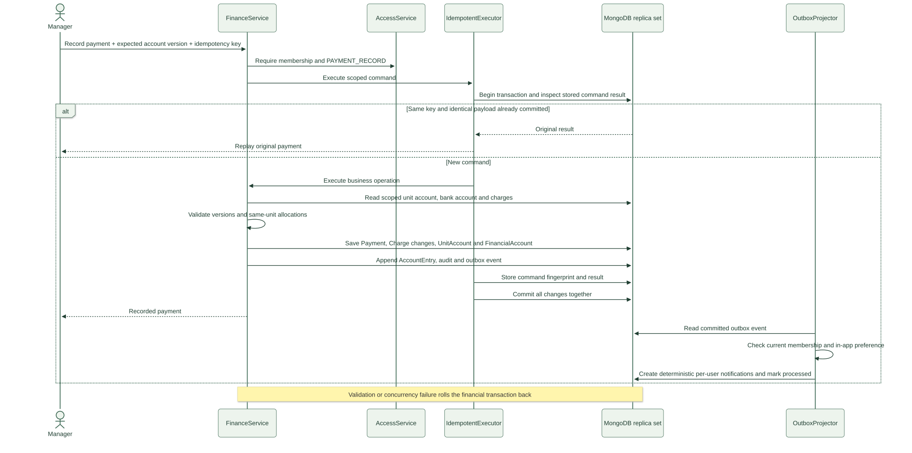

# Domain and DDD Guide

This guide describes the implemented model under `backend/src/main/java/com/govener`. It is an explanation of the current code, not a replacement for the product decisions in [DDD-DESIGN.md](../DDD-DESIGN.md). Proposed improvements are explicitly separated from existing behavior.

The system is one Spring Boot monolith. A module is a business responsibility inside that process; it is not a separately deployed microservice. These modules are useful bounded-context candidates, but their current application services still call one another directly. They are not fully isolated contexts with independently versioned integration contracts.

[Open the diagram gallery with zoom controls](diagrams/index.html). SVG files work without a Mermaid plugin; `.mmd` files are the editable sources.

## 1. Reading the model

| Term | Meaning | Example in this application |
|---|---|---|
| Domain | The business problem being modeled | Managing communities, units, shared expenses and resident requests |
| Module | A package grouping a coherent business responsibility | `finance` |
| Entity | A business object identified over time by its identity | A `Charge` keeps the same ID when partially paid |
| Value object | A value with no independent lifecycle or identity | `Money`, `BillingPeriod`, `Allocation` |
| Aggregate | A boundary in which a root controls related state and rules | `Payment` and its embedded `Allocation` values |
| Aggregate root | The entry point through which aggregate state changes | `Payment.reverse(...)` |
| Application service | Coordinates authorization, repositories, domain behavior and transactions | `FinanceService.recordPayment(...)` |
| Repository port | An application-facing abstraction for loading/saving roots | `FinancePorts.Payments` |
| Projection | A representation prepared for a particular reader | The period-limited resident account response |

An entity and an aggregate root are not competing categories: a root is an entity with responsibility for its aggregate. An aggregate does not have to contain a large object graph. Several roots in this implementation are single entities.

In the diagrams, `*--` means an embedded value owned by the aggregate. An ordinary arrow means an ID reference, not nested ownership or a database foreign key. Dashed arrows describe a workflow, dependency, snapshot, or known synchronization requirement. Cardinalities are not asserted unless the code/indexes establish them.

## 2. Module map

[Open the module diagram](diagrams/domain-modules.svg) · [Mermaid source](diagrams/domain-modules.mmd)



| Package | Business question | Main objects |
|---|---|---|
| `identity` | Who is signing in, and what are their account preferences? | `UserAccount`, `Preferences`, `PasswordReset` |
| `community` | Which site/unit/person does a record concern, and what may this user access? | `Community`, `Unit`, `Person`, `Membership`, `Relationship`, `Residence` |
| `finance` | What was charged, paid, allocated, spent, or reversed? | `Charge`, `Payment`, `UnitAccount`, `FinancialAccount`, `Expense`, `ExpensePayment`, `PaymentNotification` |
| `service` | What needs attention, and how is it progressing? | `ServiceRequest`, `RequestComment`, `RequestEvent` |
| `communication` | What information is published, and to which audience? | `Announcement`, `Audience` |
| `attachment` | Who owns this upload, and which authorized record uses it? | `Attachment` |
| `notification` | Which committed activities should be shown to this user? | `DomainEvent`, `AppNotification` |
| `shared` | Which small primitives and ports are reused? | `Money`, `BillingPeriod`, `Actor`, audit/transaction abstractions |

The module diagram shows business collaboration rather than every Java import. For example, notification delivery also reads identity preferences and community membership. `shared` is a shared implementation package, not a separate business context or a claim that every shared type belongs to a formally agreed DDD Shared Kernel.

`Community` means a managed building/site. It does not mean the management company. Company/organization, subscription and B2B customer hierarchy aggregates are not implemented. The planned Community Admin is also not a current `Role` enum value; the current values are `MANAGER` and `RESIDENT`.

## 3. Identity, people, residence and authority

[Open the community diagram](diagrams/community-relationships.svg) · [Mermaid source](diagrams/community-relationships.mmd)



These concepts answer different questions:

| Object | Question it answers | Important distinction |
|---|---|---|
| `UserAccount` | Can this account sign in? | Contains account identity/profile, preferences and password/session revocation state |
| `Person` | Which person is recorded in this community? | A person can appear in the directory without an application account |
| `Relationship` | Is this person an owner or tenant of this unit, and during which dates? | Ownership/tenancy is a dated business relationship |
| `Residence` | Does this person actually live in this unit during these dates? | A household member need not be an owner or tenant |
| `Membership` | What roles and operation permissions does this user have in this community? | Manager authority is independent of ownership/tenancy |
| `UnitAccess` | Which unit and date interval may this member access? | Embedded access grant, not a separate owner/tenant relationship record |

Example: a parent may be the owner, a tenant may sign in, another family member may physically reside there without an account, and an external professional may manage the site without living there. Those facts belong to different records.

`Membership` owns its sets of roles/permissions and its list of `UnitAccess` values. There is a unique membership index on `(communityId, userId)`. A user may have memberships in several communities. A manager still needs the permission for the operation; `MANAGER` does not grant every capability automatically.

`Person` records are community-scoped. Both `UserAccount.personId` and `Membership.personId` currently exist. The model does not define a universal one-to-one person/account relationship across all communities, and the diagrams deliberately do not promise one. Provisioning must establish consistent references; a global person identity versus community-specific person identity is a topic to refine before a company/customer hierarchy is added.

`Unit` stores `blockId` and `blockLabel`. There is no standalone `Block` aggregate today. `Community` does not embed all its units, people, or financial history.

### The important access-model gap

The confirmed product rule limits resident financial history to owner/tenant relationship periods. The current `FinancialVisibility.relationshipPeriod()` implementation reads **`Membership.units` / `UnitAccess`**, not the `Relationship` repository. Its charge check requires an access interval active today that covers the entire billing period. `FinanceQueries.payments()` additionally checks the payment date and the visibility of all allocated charges.

There is currently no application workflow that automatically derives or synchronizes these access grants when owner/tenant relationships change. Seed/provisioning data supplies them separately. Therefore, describing the implementation as if `Relationship` directly grants or revokes financial access would be inaccurate. Relationship/access consistency is a concrete improvement candidate, while keeping management authority separate.

A former relationship does not currently provide ongoing access by itself. The current-resident directory uses dated `Residence` records, independently of ownership and financial visibility.

## 4. Aggregate and value-object boundaries

Two small examples illustrate the distinction:

```text
Payment aggregate
  Payment root: id, unitId, amount, version, reversal state
  Embedded values: Money, List<Allocation>
  ID references: FinancialAccount, Charge through Allocation, optional PaymentNotification

Membership aggregate
  Membership root: id, communityId, userId, version
  Embedded values: roles, permissions, List<UnitAccess>
  ID references: UserAccount, Person, Unit through UnitAccess
```

`Allocation` contains a `chargeId`, but it has no identity of its own. It represents an amount of a payment assigned to that charge. It is stored inside `Payment`, not in a standalone allocation collection.

| Value object | Owned/used by | Why it is a value |
|---|---|---|
| `Money` | Charge/payment/expense amounts and arithmetic | Integer minor units, range checks, implicit TRY currency |
| `BillingPeriod` | `Charge` | A start/end interval; rejects an end before the start |
| `Allocation` | `Payment` | A charge reference and a positive amount, without an independent ID |
| `UnitAccess` | `Membership` | A unit reference and inclusive date interval |
| `Preferences` | `UserAccount` | Language and notification choices replaced through the account root |
| `Audience` | `Announcement` | ALL/BLOCKS/UNITS selection and validated IDs |
| `Actor` | Requests, comments, history, announcements | An ID/name snapshot describing the actor at the time |

Enums such as `Role`, `Permission` and `RequestStatus` express allowed categories; they are not entities or independently persisted roots.

The domain uses immutable Java records: operations return a new state, normally with an incremented version for mutable roots. The domain identity is the ID; Java record `equals` still compares all record components. The existence of an `Aggregate` marker alone is not proof that every persisted record is a rich business aggregate.

## 5. Finance: the unit owns the account context

[Open the finance diagram](diagrams/finance-aggregates.svg) · [Mermaid source](diagrams/finance-aggregates.mmd)



| Object | Responsibility | Rule location/example |
|---|---|---|
| `Charge` | One amount charged to a unit for a billing period | `allocate`, `release`, `cancel`; an allocated charge cannot be cancelled directly |
| `Payment` | One manager-recorded incoming payment | Unique charge allocations; allocation total cannot exceed the payment; traceable reversal |
| `Allocation` | The part of a payment assigned to a charge | Same-unit/community validation is coordinated through `ManualAllocationPolicy` |
| `UnitAccount` | Persisted unit-account totals used in financial writes | Maintains the balance invariant and is unique per community/unit |
| `FinancialAccount` | A tracked BANK or CASH account | Records incoming/outgoing movements; this is not an online bank integration |
| `AccountEntry` | A traceable unit-account movement | Separate append-only records rather than an ever-growing list inside the unit |
| `PaymentNotification` | A resident's claim that a transfer was made | Reviewing it alone does not create money or settle a charge |
| `ChargeBatch` | The result of an atomic multi-unit charge command | Embeds creation-time charge snapshots, not the live ownership of Charge aggregates |

There is one logical unit-account context per `(communityId, unitId)`. An untouched account can be returned as a zero projection before its first persisted financial write.

The persisted full-account invariant is:

```text
chargedMinor - paidMinor = outstandingMinor - creditMinor
```

Outstanding charge amount and unallocated credit may coexist. Existing credit is not silently allocated to a newly created charge. `UnitAccount` is a business write-side summary, not an asynchronously updated dashboard cache. The resident-facing `AccountProjection` is a different, visibility-limited read representation; it is not another aggregate or a separate MongoDB collection.

A charge belongs to the unit when its owner or tenant changes. The model does not thereby decide a person's legal liability. A new resident's visibility and the site's retained financial history are separate concerns.

`ChargeBatch.charges` is a deliberate exception to the usual ID-reference pattern: these are immutable snapshots of the created charges. Later allocation/cancellation changes update the independent Charge documents; they do not rewrite the original batch result. Consumers must use charge/account queries for current state.

### Example: a partial payment

Assume an initial zero balance and one charge of TRY 2,400:

1. The charge is `240000` minor units; `UnitAccount.chargedMinor` and `outstandingMinor` become `240000`.
2. A resident reports a TRY 1,000 transfer using `PaymentNotification`. The unit's financial balances do not change.
3. A manager records a `Payment` of `100000` and explicitly allocates all of it to the charge.
4. The charge now has `allocatedMinor = 100000`; the unit has `paidMinor = 100000`, `outstandingMinor = 140000`, and `creditMinor = 0`. The tracked bank/cash account increases by `100000`.
5. Reversing that payment restores those monetary effects and releases the charge allocation, while retaining the original payment and a reversal movement. A linked payment notification returns to `REVIEWED`.

If the recorded amount had instead been TRY 2,600 with TRY 2,400 allocated, the remainder would be TRY 200 credit. No automatic allocation order, proration or interest calculation is implied.

## 6. Requests, announcements, files and outgoing expenses

[Open the supporting-model diagram](diagrams/collaboration-records.svg) · [Mermaid source](diagrams/collaboration-records.mmd)



- `ServiceRequest` controls the current request state, assignment, creator snapshot and bounded photo ID list. Status values are OPEN, IN_PROGRESS and RESOLVED. `RequestService` supplies authorization, expected-version checks and event recording.
- `RequestComment` and `RequestEvent` are separate persisted records referring to `requestId`. They are not an unbounded embedded collection in `ServiceRequest`.
- `Announcement` owns its `Audience` value. `AnnouncementService` checks that selected unit/block IDs belong to the community and applies publication/audience access to reads. Its author is an `Actor` snapshot.
- `Expense` records an incurred cost. `ExpensePayment` records a particular outgoing settlement of that cost and references `FinancialAccount`. Several partial settlements can pay one expense. Expense paid totals and the account balance are updated transactionally.
- `Attachment` is an independently persisted metadata root. Requests reference photo IDs, notifications reference receipt IDs, and expenses reference document IDs. Metadata also records its parent binding. The binary content lives in GridFS, outside the domain model.
- `DomainEvent` is the implementation's transactional outbox record, including processing state. `AppNotification` is the per-user delivery/read record. They are different objects; the system is not event sourced.

## 7. What belongs to the same transaction?

[Open the payment sequence](diagrams/payment-recording.svg) · [Mermaid source](diagrams/payment-recording.mmd)



`Payment`, `Charge`, `UnitAccount` and `FinancialAccount` are distinct aggregates. They are not embedded inside each other. Nevertheless, the current monolith deliberately updates them in **one multi-document MongoDB transaction** when recording a payment, together with applicable notification matching, account entries, audit, outbox and the idempotent result.

This is a pragmatic consistency choice for financial operations, not a claim that an aggregate and a transaction are universally the same thing. Invariants local to an aggregate remain on that aggregate; cross-aggregate checks and atomic coordination live in application services. Repository adapters perform compare-and-swap version checks. A stale/concurrent write fails instead of silently retrying the mutation.

After commit, `OutboxProjector` creates per-user notifications using deterministic event/user IDs and current membership/preferences. Notification delivery does not control whether the financial transaction committed. The outbox stores activity messages; it is not a complete event stream from which all aggregates are reconstructed.

## 8. Complete persistence inventory

Every record below implements `Aggregate` or `ScopedAggregate` and has its own persistence boundary today. The classification distinguishes business roots from supporting records; it does not declare every technical record a separate business bounded context.

| Module | Java record | MongoDB collection | Classification |
|---|---|---|---|
| identity | `UserAccount` | `users` | Business root |
| identity | `PasswordReset` | `password_resets` | Expiring identity workflow record |
| identity | `ResetEmail` | `reset_email_outbox` | Encrypted delivery/lease record |
| community | `Community` | `communities` | Business root |
| community | `Unit` | `units` | Business root |
| community | `Person` | `people` | Business root |
| community | `Membership` | `memberships` | Access root |
| community | `Relationship` | `relationships` | Dated business relationship root |
| community | `Residence` | `residences` | Dated occupancy root |
| finance | `Charge` | `charges` | Business root |
| finance | `Payment` | `payments` | Business root |
| finance | `UnitAccount` | `unit_accounts` | Financial summary root |
| finance | `FinancialAccount` | `financial_accounts` | Business root |
| finance | `Expense` | `expenses` | Business root |
| finance | `ExpensePayment` | `expense_payments` | Settlement root |
| finance | `PaymentNotification` | `payment_notifications` | Resident reporting workflow root |
| finance | `ChargeBatch` | `charge_batches` | Creation-result snapshot |
| finance | `AccountEntry` | `account_entries` | Append-only account movement |
| finance | `IdempotentResult` | `idempotency_results` | Expiring command result/fingerprint |
| service | `ServiceRequest` | `requests` | Business root |
| service | `RequestComment` | `request_comments` | Append-only conversation record |
| service | `RequestEvent` | `request_events` | Append-only request history record |
| communication | `Announcement` | `announcements` | Business root |
| attachment | `Attachment` | `attachments` | Metadata/binding root |
| notification | `DomainEvent` | `outbox_events` | Activity payload plus delivery state |
| notification | `AppNotification` | `notifications` | Per-user notification/read record |
| shared | `AuditRecord` | `audit_records` | Append-only audit record |

Infrastructure collections such as GridFS `fs.files`/`fs.chunks`, authentication attempt counters and request-number sequences are not additional domain aggregates. HTTP DTOs under `adapter/in/web/dto` are transport contracts, also not domain entities.

MongoDB does not supply relational foreign keys for these arrows. Scope/reference checks occur in use cases and selected uniqueness indexes. A current ID reference also does not imply automatic deletion or cascading updates.

## 9. Good next design discussions

These are observations/recommendations, not changes performed by this documentation task:

1. **Relationship/access consistency:** decide which record is authoritative for resident date intervals, then implement an explicit provisioning/change workflow. Keep management capabilities separate from tenancy.
2. **Person identity scope:** clarify how a global login relates to community-scoped Person records across several sites; specify consistency for `UserAccount.personId`, `Membership.personId` and profile/name updates.
3. **Business roots versus technical records:** review whether the common aggregate marker/repository abstraction communicates the difference between mutable roots, append-only history, query projections and delivery/idempotency records clearly enough.
4. **Module contracts:** decide where direct application-service calls should become explicit module-facing ports, especially around access, attachments and notification publication. The current structure is a monolith with cross-module collaboration.
5. **Financial consistency and contention:** retain atomic monetary guarantees while evaluating the transaction sizes, shared bank-account writes and ChargeBatch snapshot cost at production scale. This does not automatically require microservices.

A separate Block root or management-company/customer hierarchy should be introduced when its own lifecycle and business rules are defined. The diagram should not invent those aggregates before the product needs them.

## 10. Code reading route

Read these together to connect the diagrams to behavior:

- [Membership](../backend/src/main/java/com/govener/community/domain/Membership.java), [Relationship](../backend/src/main/java/com/govener/community/domain/Relationship.java), [Residence](../backend/src/main/java/com/govener/community/domain/Residence.java), [AccessService](../backend/src/main/java/com/govener/community/application/AccessService.java).
- [Payment](../backend/src/main/java/com/govener/finance/domain/Payment.java), [Charge](../backend/src/main/java/com/govener/finance/domain/Charge.java), [UnitAccount](../backend/src/main/java/com/govener/finance/domain/UnitAccount.java).
- [FinanceService](../backend/src/main/java/com/govener/finance/application/FinanceService.java), [ManualAllocationPolicy](../backend/src/main/java/com/govener/finance/application/ManualAllocationPolicy.java), [FinancialVisibility](../backend/src/main/java/com/govener/finance/application/FinancialVisibility.java), [FinanceQueries](../backend/src/main/java/com/govener/finance/application/FinanceQueries.java).
- [ServiceRequest](../backend/src/main/java/com/govener/service/domain/ServiceRequest.java), [RequestService](../backend/src/main/java/com/govener/service/application/RequestService.java), [Announcement](../backend/src/main/java/com/govener/communication/domain/Announcement.java).
- [MongoAggregateRepository](../backend/src/main/java/com/govener/shared/adapter/out/mongo/MongoAggregateRepository.java), [MongoIndexes](../backend/src/main/java/com/govener/configuration/MongoIndexes.java), [OutboxProjector](../backend/src/main/java/com/govener/notification/application/OutboxProjector.java).
